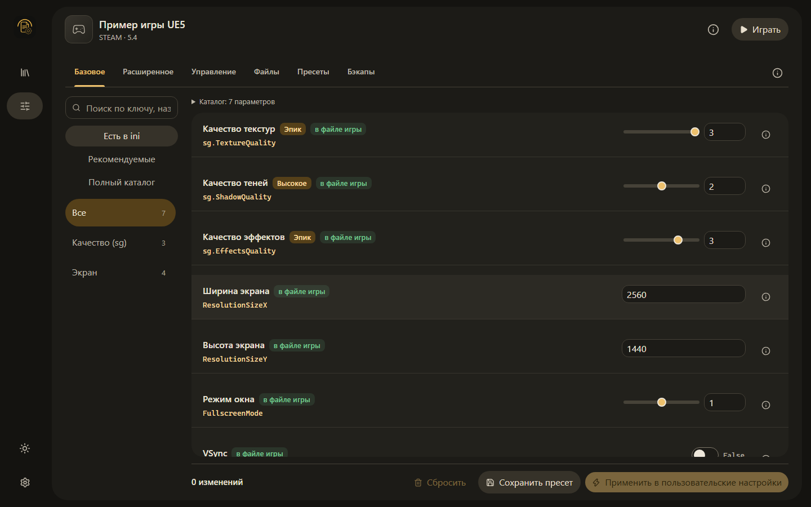
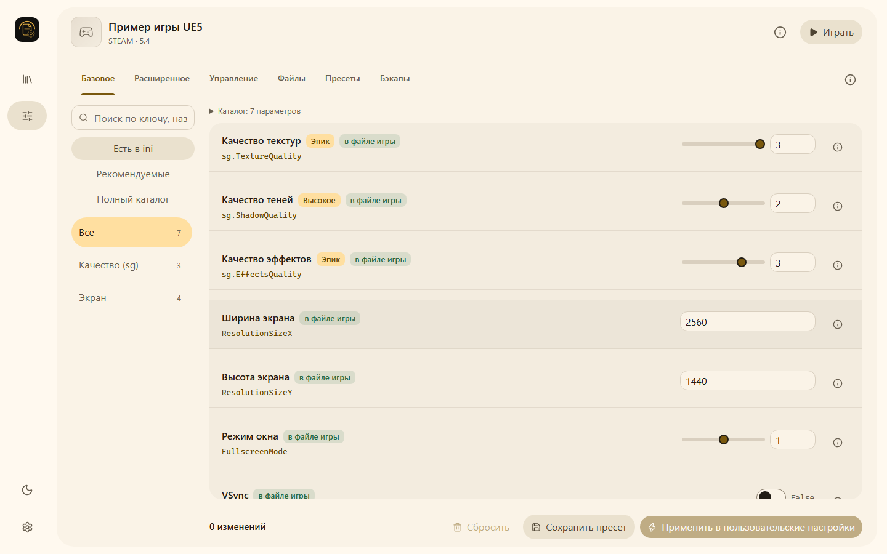

# Material interface

The application uses a shared Material 3 inspired surface hierarchy in both light and dark themes. The amber primary color remains the main action color; filled buttons use a dedicated foreground role so their labels retain contrast in either palette. No UI framework or runtime dependency is added.

| Dark theme | Light theme |
| --- | --- |
|  |  |

Screenshots use isolated demonstration data.

## Workspace behavior

- The navigation rail contains the project icon, library, current editor, theme toggle and application settings.
- The game header contains the selected game, source, engine version, game details and launch control. Configuration paths, GPU selection and launch options are available in game details.
- Editor sections use compact tabs with arrow, Home and End keyboard navigation. Section explanations are available through the information button.
- Parameter descriptions open through a labeled information button. Hovering or editing a value does not reserve a description column or open an overlay.
- Catalog statistics are expandable. Changed diagnostics, validation errors and conflicting settings remain visible in the workspace.
- Preset name and compatibility fields are in a separate dialog with a scrolling body and fixed actions. Both selected changes and full editable profiles remain available.
- Input entries, text files, presets and snapshots use the same color and shape roles. Override reset remains available after the backup list.

Native modal dialogs make background controls inert. The prepared-changes preview also uses the native top layer so a diagnostic reapply from game details appears above the details dialog. Closing a dialog restores its opener's focus; diagnostic actions wait until their disabled button becomes available again.

## Verification

Run the existing frontend build, unit tests, localization parity check and Playwright suite. `e2e/material-workspace.spec.ts` covers both languages and palettes, keyboard navigation, explicit parameter details, game details, theme persistence, short windows at 125% text size, visible apply controls and nested diagnostic preview cancellation/application. Existing workflows continue to cover draft preservation, selected changes, restoration, INI text and input mappings.

The isolated demo entry accepts `/e2e.html?lang=ru&theme=light` and `/e2e.html?lang=en&theme=dark` when started with `GSM_E2E=1`. It uses in-memory IPC fixtures and does not access installed games. The normal application entry still uses the existing backend.

Browser checks do not replace a Windows WebView2 check. Validate the packaged application on Windows before releasing the redesign. This change does not create a release or alter the application version.
