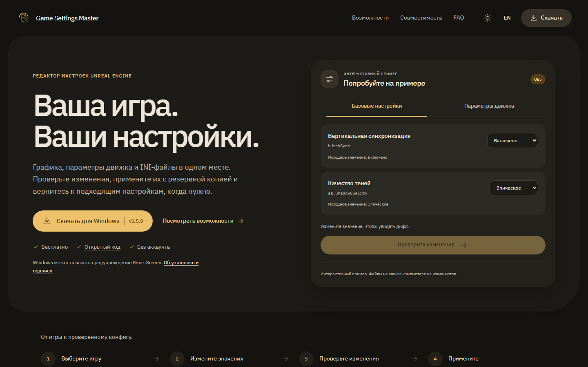
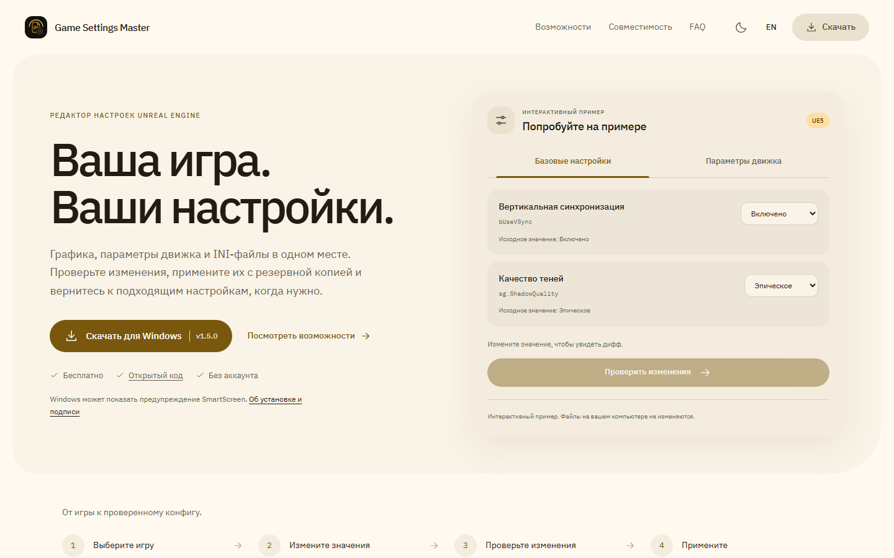

# Material landing

The RU/EN product site uses the application's warm neutral, amber and tonal Material 3 color roles. The layout introduces the editor with an interactive example, then explains preview, selective restore and post-game diagnostics through captured application components. A separate tools section includes the INI text editor, presets, hardware selection and classic input mappings.

| Dark palette | Light palette |
| --- | --- |
|  |  |

[Mobile first screen](design/landing/mobile.webp) · [Interactive diff](design/landing/preview.webp)

## Interaction and content

The theme follows the operating system until the visitor chooses a palette. The choice persists across reloads and language navigation; illustration sources change with the palette. Switching themes preserves the example's drafts, selected edits and current stage. The small first-paint script handles storage failures and invalid URL preferences.

Product copy, download links, compatibility details and FAQ are generated as HTML at build time. They remain usable with JavaScript disabled. The example only changes its own in-memory values. Hardware support, game plugin support and classic input limitations remain explicit; no performance guarantees or verified game profiles are implied.

The versioned Windows download uses the root package version. The app release, backend, dependencies and hosting provider are unchanged. The site has no Telegram links.

## Verification

The production build and 47 Playwright checks cover both languages, both palettes, four viewport sizes at 100% and 125%, preview exclusions, empty selection, reset, per-mode drafts, keyboard focus, reduced motion, static HTML, metadata, local images, theme persistence and storage failures.

Visual review includes 1440x900, 1280x720, 768x1024 and 390x844. New screenshot fragments come from the actual preview, snapshot and diagnostic components with demonstration data in both palettes. Social cards are 1200x630.
